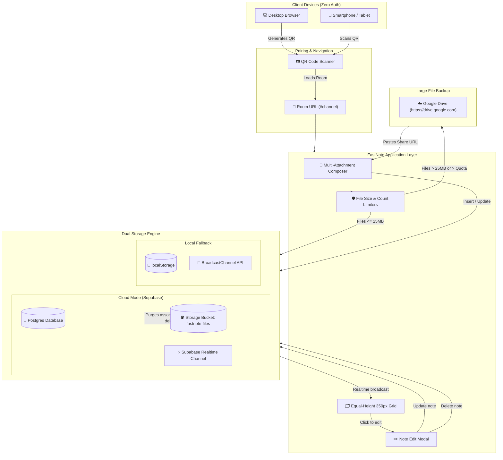

# FastNote 📝⚡

[](https://react.dev/)
[](https://www.typescriptlang.org/)
[](https://vite.dev/)
[](https://tailwindcss.com/)
[](https://supabase.com/)
[](LICENSE)

> **Instant, zero-friction cross-device clipboard & sticky notes.**  
> Effortlessly beam text snippets, website links, multiple images, and PDF documents between your computer, smartphone, and tablet in real time — with zero login, zero accounts, and zero app installs required.

---

## 📑 Table of Contents

- [The Problem FastNote Solves](#-the-problem-fastnote-solves)
- [Key Features](#-key-features)
  - [1. Multi-Attachment Sticky Notes](#1-multi-attachment-sticky-notes)
  - [2. Architectural Equal-Size Note Grid](#2-architectural-equal-size-note-grid)
  - [3. Interactive In-Place Edit Modal](#3-interactive-in-place-edit-modal)
  - [4. Google Drive Backup Workflow](#4-google-drive-backup-workflow)
  - [5. Smart Upload Limiters & Storage Health](#5-smart-upload-limiters--storage-health)
  - [6. Instant QR Code Device Pairing](#6-instant-qr-code-device-pairing)
  - [7. Dual-Engine Synchronization](#7-dual-engine-synchronization)
  - [8. Stationery Aesthetics & Editorial Design](#8-stationery-aesthetics--editorial-design)
- [System Architecture](#-system-architecture)
- [Project Directory Structure](#-project-directory-structure)
- [Tech Stack](#-tech-stack)
- [Getting Started](#-getting-started)
  - [Prerequisites](#prerequisites)
  - [Installation](#installation)
  - [Environment Variables](#environment-variables)
  - [Development Server](#development-server)
- [Supabase Setup (Database & Storage)](#-supabase-setup-database--storage)
- [Deployment Guide](#-deployment-guide)
  - [Deploying to Vercel](#deploying-to-vercel)
  - [Deploying to Netlify](#deploying-to-netlify)
- [Keyboard Shortcuts](#-keyboard-shortcuts)
- [License](#-license)

---

## 💡 The Problem FastNote Solves

We transfer information between our laptops and phones dozens of times a day:
- A two-factor code or tracking URL on a laptop that needs to be opened on a phone.
- A photo or receipt taken with a phone camera that needs to be dropped into a document on desktop.
- A quick PDF invoice that needs to be referenced across devices without saving it to temporary downloads.

Traditional solutions are clumsy: emailing yourself clutters your inbox, messaging apps require accounts or leaving active chats, and Bluetooth pairing frequently drops or fails across operating systems (macOS, Windows, iOS, Android).

**FastNote fixes this with zero setup:**
1. Open FastNote in your browser.
2. Click **"Connect Phone"** to reveal a high-contrast QR code.
3. Scan the code with your phone camera.
4. **Both devices are now synchronized in real time.** Type, paste, or drop anything onto the board and it instantly appears on the other screen.

---

## ✨ Key Features

### 1. Multi-Attachment Sticky Notes
Why create separate notes for text, links, and screenshots when they belong together? FastNote allows you to combine:
- **Title & Body Text**: Notes, reminders, and thoughts with auto-wrapping typography.
- **Web Links**: Clickable URL cards with automatic domain parsing and one-click copy buttons.
- **Multiple Images**: Attach up to 5 photos or screenshots per note. Single images display as full-width previews, while multiple images render as responsive thumbnail galleries with lightbox zoom.
- **Multiple PDF Documents**: Attach up to 3 PDF documents per note with file name, file size badges, and quick-open buttons.
- **Global Clipboard Interception**: Press `Ctrl + V` anywhere on the screen to automatically capture clipboard images or auto-populate links into the composer.

### 2. Architectural Equal-Size Note Grid
Unlike messy masonry layouts where notes jump around in height as files load, FastNote uses a strict **equal-height grid** (`350px`).
- Every note card aligns perfectly to the same horizontal baseline.
- Body content and file attachments scroll smoothly inside the note container.
- Meta badges and action bars are pinned to identical positions across the entire grid.

### 3. Interactive In-Place Edit Modal
Need to update an existing note? Simply click any sticky note card or its edit pencil icon:
- Full-screen distraction-free modal interface.
- Add or remove individual images and PDF attachments without rebuilding the note.
- Update body copy, alter URLs, change stationery paper tints, or toggle priority pinned status.
- Hit `Ctrl + Enter` to save or `Esc` to cancel.

### 4. Google Drive Backup Workflow
Need to share huge video files, archives, or high-resolution folders that exceed free cloud storage?
- Click the **"Drive Backup ↗"** button in the composer or edit modal to jump straight to [Google Drive](https://drive.google.com).
- The Link input automatically expands with guidance prompting you to paste the share URL.
- Pasted Google Drive links are automatically recognized, badged with an amber **Google Drive** icon, and rendered as dedicated navigation links on the note card.

### 5. Smart Upload Limiters & Storage Health
To prevent accidental storage bloat and maintain blazing-fast synchronization:
- **Quota limits**: Up to **5 images** and **3 PDF documents** per note.
- **Size limit**: Up to **25 MB** per individual file.
- **Live Counter Pills**: Visual status indicators (`2/5 Images`, `1/3 PDFs`) that update in real time and politely disable file pickers when full.
- **Exceeded Limit Banner**: If a user selects too many files or drops oversized media, a helpful banner provides an immediate shortcut to Google Drive.
- **Automatic Storage Garbage Collection**: When a note is deleted, FastNote automatically sends a batch deletion command to Supabase Storage to immediately free up bucket capacity.

### 6. Instant QR Code Device Pairing
FastNote syncs via simple room channels (e.g. `#desk-sync`, `#project-x`).
- Click **"Connect Phone"** in the top navigation bar.
- FastNote generates a high-contrast QR code pointing directly to your active channel URL.
- Point your phone camera at the screen and tap the link to pair immediately.
- Custom channels can be renamed at any time with real-time room hopping.

### 7. Dual-Engine Synchronization
FastNote never leaves you stranded if your connection drops or if you haven't set up backend keys yet:
- **Supabase Cloud Engine**: Connects to Supabase PostgreSQL, listens to `supabase_realtime` change feeds, and stores binary media in Supabase Storage.
- **Local Fallback Engine**: If Supabase credentials are not provided or the network is offline, FastNote transparently falls back to `localStorage` and the browser `BroadcastChannel` API, keeping multiple tabs and local windows in sync.

### 8. Stationery Aesthetics & Editorial Design
Crafted with strict anti-slop design principles inspired by physical desk stationery:
- **Palette**: Warm stone canvas (`#F9F8F6`), deep ink text (`#1A1815`), and warm amber accent (`#B45309`).
- **5 Stationery Paper Tints**:
  - 📄 **White Linen**: Classic clean white parchment.
  - 🧈 **Warm Butter**: Soft subtle cream tint.
  - 🌿 **Soft Sage**: Gentle muted botanical green.
  - ☁️ **Morning Sky**: Calm subtle slate blue.
  - 🌸 **Pale Blush**: Warm muted rose blush.
- **Typography**: [Plus Jakarta Sans](https://fonts.google.com/specimen/Plus+Jakarta+Sans) for editorial prose + [JetBrains Mono](https://fonts.google.com/specimen/JetBrains+Mono) for sync codes and file metadata.
- **Zero UI Slop**: 0 emojis in chrome headers/buttons, no AI-generic purple gradients, and strict micro-animations.

---

## 📐 System Architecture



---

## 📂 Project Directory Structure

```text
fastnote/
├── public/
│   ├── _redirects              # Netlify SPA redirect rules
│   └── favicon.svg             # Minimalist FastNote icon
├── src/
│   ├── components/
│   │   ├── Composer.tsx        # Multi-attachment sticky note creator with quota checks
│   │   ├── EmptyState.tsx      # Helpful welcome illustration & quick tips
│   │   ├── FilterBar.tsx       # Streamlined 4-filter switcher (All, Images, PDFs, Pinned)
│   │   ├── Header.tsx          # Channel sync indicator, device badge, and modals trigger
│   │   ├── ImageLightbox.tsx   # Full-screen image lightbox preview modal
│   │   ├── NoteCard.tsx        # Architectural 350px equal-height sticky note component
│   │   ├── NoteEditModal.tsx   # Comprehensive in-place editor modal
│   │   ├── QrModal.tsx         # High-contrast mobile pairing QR code generator
│   │   └── SupabaseModal.tsx   # In-app cloud sync configuration dialog
│   ├── lib/
│   │   ├── storage.ts          # Unified storage controller (Supabase Cloud + Local fallback)
│   │   ├── supabase.ts         # Supabase client instantiation & connection validator
│   │   └── utils.ts            # Quota constants, date helpers, color maps, device detection
│   ├── App.tsx                 # Root application controller & realtime event listener
│   ├── index.css               # Tailwind CSS v4 directives & paper shadows
│   ├── main.tsx                # React DOM entry point
│   └── types.ts                # TypeScript interfaces for notes, files, colors, and attachments
├── .env.example                # Template for environment variables
├── index.html                  # HTML entry point with font preloads
├── package.json                # Project dependencies & scripts
├── supabase_schema.sql         # Complete production SQL setup for Supabase
├── tsconfig.json               # TypeScript compiler configuration
├── vercel.json                 # Vercel SPA routing configuration
└── vite.config.ts              # Vite configuration
```

---

## 🛠️ Tech Stack

| Category | Technology | Description |
| :--- | :--- | :--- |
| **Framework** | [React 19](https://react.dev/) | Modern concurrent UI architecture |
| **Build Tool** | [Vite 8](https://vite.dev/) | Sub-millisecond HMR and optimized Rolldown/ESBuild bundling |
| **Language** | [TypeScript 5.9](https://www.typescriptlang.org/) | Strict type-safety across all note components |
| **Styling** | [Tailwind CSS v4](https://tailwindcss.com/) | High-performance CSS engine without config bloat |
| **Icons** | [Lucide React](https://lucide.dev/) | Clean, geometric iconography |
| **QR Code** | [qrcode.react](https://github.com/zpao/qrcode.react) | SVG-based QR code rendering for mobile device pairing |
| **Database** | [PostgreSQL (Supabase)](https://supabase.com/) | Reliable relational storage for notes and metadata |
| **Realtime** | [Supabase Realtime](https://supabase.com/realtime) | WebSocket pub/sub for instantaneous cross-device push |
| **Storage** | [Supabase Storage](https://supabase.com/storage) | S3-compatible public bucket for image and PDF binary files |

---

## 🚀 Getting Started

### Prerequisites
- [Node.js](https://nodejs.org/) (version 18.x or higher)
- [npm](https://www.npmjs.com/) or [pnpm](https://pnpm.io/)
- *(Optional)* A free [Supabase](https://supabase.com/) project for cloud sync

### Installation

1. **Clone the repository:**
   ```bash
   git clone https://github.com/your-username/fastnote.git
   cd fastnote
   ```

2. **Install project dependencies:**
   ```bash
   npm install
   ```

3. **Configure environment variables:**
   Copy the example environment file:
   ```bash
   cp .env.example .env
   ```

   Fill in your Supabase project credentials in `.env`:
   ```env
   VITE_SUPABASE_URL=https://your-project.supabase.co
   VITE_SUPABASE_ANON_KEY=your-anon-public-key
   ```
   *(Note: If you leave these blank, FastNote will still work in local mode across browser tabs via localStorage & BroadcastChannel!)*

4. **Start the local development server:**
   ```bash
   npm run dev
   ```
   Open your browser at `http://localhost:5173`.

5. **Build for production:**
   ```bash
   npm run build
   ```

---

## 🗄️ Supabase Setup (Database & Storage)

To set up cross-device cloud sync and file hosting in your own Supabase project:

1. Open your [Supabase Dashboard](https://supabase.com/dashboard).
2. Navigate to **SQL Editor &rarr; New Query**.
3. Paste and run the following script (also available in [`supabase_schema.sql`](supabase_schema.sql)):

```sql
-- ==============================================================================
-- 1. Create the 'notes' table
-- ==============================================================================
CREATE TABLE IF NOT EXISTS public.notes (
  id UUID PRIMARY KEY DEFAULT gen_random_uuid(),
  room_id TEXT NOT NULL,
  type TEXT NOT NULL CHECK (type IN ('text', 'link', 'image', 'pdf')),
  title TEXT,
  content TEXT NOT NULL,
  color TEXT NOT NULL DEFAULT 'linen',
  pinned BOOLEAN NOT NULL DEFAULT false,
  file_url TEXT,
  file_name TEXT,
  file_size BIGINT,
  device_type TEXT,
  created_at TIMESTAMPTZ NOT NULL DEFAULT now()
);

-- ==============================================================================
-- 2. Indexes for high-speed room queries
-- ==============================================================================
CREATE INDEX IF NOT EXISTS idx_notes_room_id ON public.notes(room_id);
CREATE INDEX IF NOT EXISTS idx_notes_created_at ON public.notes(created_at DESC);

-- ==============================================================================
-- 3. Row Level Security (RLS) Policies
-- ==============================================================================
ALTER TABLE public.notes ENABLE ROW LEVEL SECURITY;

CREATE POLICY "Allow anonymous read access by room"
ON public.notes FOR SELECT TO anon, authenticated USING (true);

CREATE POLICY "Allow anonymous insert access"
ON public.notes FOR INSERT TO anon, authenticated WITH CHECK (true);

CREATE POLICY "Allow anonymous update access"
ON public.notes FOR UPDATE TO anon, authenticated USING (true) WITH CHECK (true);

CREATE POLICY "Allow anonymous delete access"
ON public.notes FOR DELETE TO anon, authenticated USING (true);

-- ==============================================================================
-- 4. Enable Supabase Realtime for instant synchronization
-- ==============================================================================
ALTER PUBLICATION supabase_realtime ADD TABLE public.notes;

-- ==============================================================================
-- 5. Storage Bucket setup for images and PDFs
-- ==============================================================================
INSERT INTO storage.buckets (id, name, public)
VALUES ('fastnote-files', 'fastnote-files', true)
ON CONFLICT (id) DO NOTHING;

CREATE POLICY "Public read bucket access"
ON storage.objects FOR SELECT TO anon, authenticated 
USING (bucket_id = 'fastnote-files');

CREATE POLICY "Public insert bucket access"
ON storage.objects FOR INSERT TO anon, authenticated 
WITH CHECK (bucket_id = 'fastnote-files');

CREATE POLICY "Public delete bucket access"
ON storage.objects FOR DELETE TO anon, authenticated 
USING (bucket_id = 'fastnote-files');
```

---

## 🚢 Deployment Guide

FastNote is a Single Page Application (SPA). To ensure clean routing and query parameter persistence (such as `?room=my-desk`):

### Deploying to Vercel
1. Push your code to GitHub.
2. In [Vercel](https://vercel.com), click **Add New Project** and select the repository.
3. Under **Environment Variables**, add:
   - `VITE_SUPABASE_URL`: `https://your-project.supabase.co`
   - `VITE_SUPABASE_ANON_KEY`: `your-anon-public-key`
4. Click **Deploy**. Vercel will automatically detect `vercel.json` and route all queries properly.

### Deploying to Netlify
1. Connect your repository in [Netlify](https://netlify.com).
2. Configure build settings:
   - **Build Command**: `npm run build`
   - **Publish directory**: `dist`
3. Add `VITE_SUPABASE_URL` and `VITE_SUPABASE_ANON_KEY` under **Site configuration &rarr; Environment variables**.
4. The included `public/_redirects` file ensures all sub-routes rewrite cleanly to `index.html`.

---

## ⌨️ Keyboard Shortcuts

| Shortcut | Action | Where |
| :--- | :--- | :--- |
| <kbd>Ctrl</kbd> + <kbd>Enter</kbd> (or <kbd>⌘</kbd> + <kbd>Enter</kbd>) | Submit & sync sticky note | Composer & Note Edit Modal |
| <kbd>Esc</kbd> | Close modal / cancel editing | Note Edit Modal & Lightbox |
| <kbd>Ctrl</kbd> + <kbd>V</kbd> (or <kbd>⌘</kbd> + <kbd>V</kbd>) | Paste clipboard image / auto-populate link | Anywhere on page |

---

## 📄 License

Distributed under the **MIT License**. See `LICENSE` for more information. Free to use, adapt, and self-host for personal and commercial projects.
